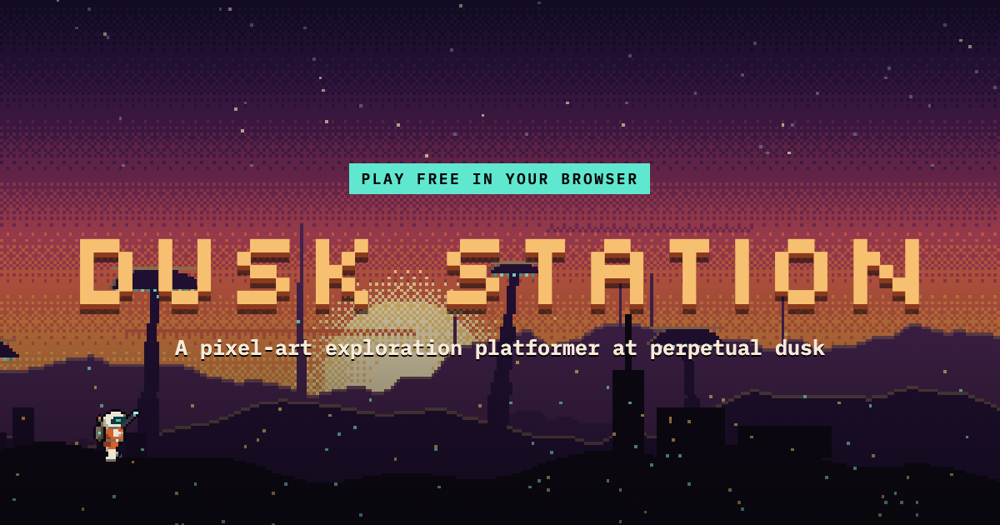

# Dusk Station

**[Play it in your browser →](https://nearbycoder.github.io/dusk-station/)**

A pixel-art side-scrolling exploration action game. A lone surveyor lands beside an abandoned research station beneath an alien wilderness at perpetual dusk, recovers an air dash and magnetic boots, wakes the buried reactor, defeats its overgrown guardian and restores the surface beacon. A first run takes about 15–20 minutes.

The game is one self-contained file, [`play/index.html`](play/index.html), with no libraries and no image or audio files. The world, characters and interface are drawn with Canvas 2D at 320×180 and scaled up with nearest-neighbour; every sound is synthesised with Web Audio. The only external resources are two Google Fonts (Silkscreen and IBM Plex Mono), with monospace fallbacks when offline.

- Website with the embedded game: https://nearbycoder.github.io/dusk-station/
- The game on its own, full screen: https://nearbycoder.github.io/dusk-station/play/
- Mirror: https://dusk-station.site.yeeet.dev

## Play

Open the site, or open `play/index.html` straight from disk. Sound is off by default; turn it on from the title or pause menu.

| Action | Keyboard | Controller | Touch |
| --- | --- | --- | --- |
| Move | A / D or ← → | Left stick or d-pad | D-pad |
| Jump (hold for height) | Space or Z | A (✕) | JUMP |
| Fire (hold and release to charge) | J or X | X (□) or RT (R2) | FIRE |
| Dash (once found) | K or C | B (○), RB, LB or LT | DASH |
| Crouch | S or ↓ | Stick down | D-pad down |
| Use / aim up | W or ↑ | Y (△) or stick up | D-pad up |
| Drop through a grate | S + Space | Down + A | down + JUMP |
| Map | M | View (Create) | MAP |
| Pause | Esc | Menu (Options) | II |

Controllers use the browser Gamepad API with the standard layout. Button prompts follow whichever device you used last and switch to Xbox, PlayStation or Nintendo labels to match the pad. There is light rumble (off from the pause menu), and unplugging a controller mid-game pauses it.

Progress saves at rest pods (and on upgrades, shortcuts and boss kills) to `localStorage`. If storage is blocked the game still runs; it just can't save. The game pauses itself when it loses focus.

## World

Fifteen hand-authored rooms in three regions plus the surface:

- **Landing Complex**: the landing site, the concourse hub (rest pod, collapsed walkway to the reactor lift), the observation deck and the service shaft.
- **Flooded Laboratories**: the atrium, the specimen gallery, a lab shelter, the containment vault (Warden Sentinel, air dash) and the pump shaft that opens a hatch back into the landing site.
- **Buried Reactor**: the descent, the magnetics bay (magnetic boots, a high shortcut door back to the atrium), the coolant spire (core release), the core shelter and the reactor core (the Custodian).
- **Beacon Ridge**: reached by the surface lift after the final fight.

Optional finds: four suit cells and one pulse amplifier, behind cracked panels, membranes and wall-jump climbs. A reduced-motion option disables screen shake, parallax motion and hit-stop.

## Repository layout

| Path | What it is |
| --- | --- |
| `play/index.html` | The game. One file, nothing else needed. |
| `index.html` | The website (GitHub Pages landing page) with the game embedded. |
| `assets/` | Website styles and script, plus screenshots, render layers, sprites and the gameplay video, all captured from the game itself. |

To preview the website locally, serve the folder (for example `python3 -m http.server`) and open it in a browser; the embedded player loads `play/` in an iframe.

## How the game is built

`play/index.html` is organised into clearly separated sections: core utilities and palettes, room data, world and collision, input, audio and saving, player, enemies, boss, objects, game state and menus, then rendering (cached room layers, scenery, sprites, interface) and a fixed-timestep main loop. `window.DS` exposes hooks that the automated tests use to drive the game: a scripted playthrough from a fresh save to the ending, randomised stress runs, save/reload checks and multi-touch tests in a headless browser.
